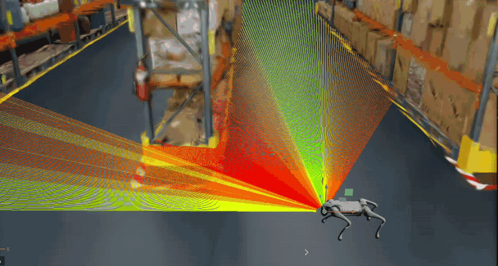
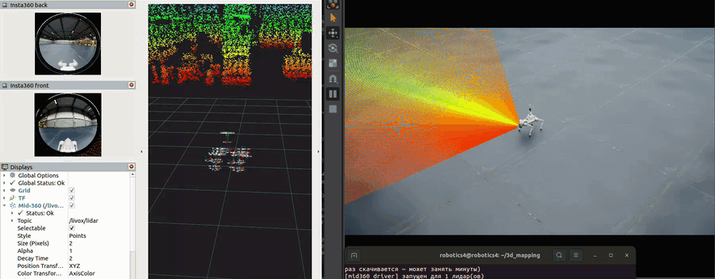
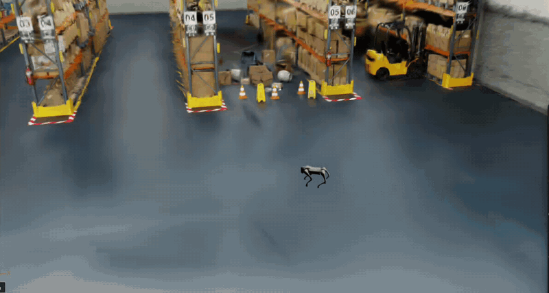

# 3d_mapping — Mid-360 + Insta360 → 3D-модель помещения для Isaac Sim

<p align="center"></p>

**English.** Diploma project: mapping indoor spaces with a Livox Mid-360 lidar and an Insta360
(two fisheye lenses) on a Unitree Go2, and turning the recording into simulation-ready models for
NVIDIA Isaac Sim — a colored mesh with collider, a colored point cloud (LAZ / E57 / USD), Gaussian
splats (3DGRUT → NuRec) and CAD (STEP / DXF) for single rooms. Developed in simulation against
ground truth: drive the robot with WASD in Isaac Sim, re-render the drive with full sensors, then
RKO-LIO odometry → mesh → color → USD. Other robots (Unitree G1, Go2 from IsaacLegs) can then walk
in the reconstructed model. Documentation below is in Russian.

Дипломный проект: съёмка помещения лидаром Livox Mid-360 и 360-камерой Insta360 на роботе
Unitree Go2, обработка в 3D-модель (меш с коллайдером, облако, гауссианы, CAD) и возврат
модели в Isaac Sim для роботов. Пока всё отлаживается в симуляции, с эталоном для сравнения.

| Съёмка: Go2 с надстройкой, RViz (оба fisheye и облако Mid-360) | Go2 в модели склада из гауссиан |
|---|---|
|  |  |

```
Isaac Sim: Go2 + Mid-360 + Insta360, езда WASD ──► запись поз робота (data/drives/)
  ──► перерисовка поездки с полными датчиками: лидар со временем точек, fisheye 1920 px, IMU
  ──► RKO-LIO ──► выравнивание по силе тяжести ──► уточнение траектории (скан к карте других проходов)
  ──► меш (Poisson, сглаживание с острыми рёбрами) + пол под путём робота ──► цвет с камер
  ──► USD (меш + коллайдер), LAZ / E57, CAD для комнат
  ──► гауссианы (3DGRUT): позы камер уточняются по самим снимкам (COLMAP), штрафы против «иголок»
  ──► роботы ходят по модели в Isaac Sim
```

Поездка по складу (Full Warehouse, 70 м, 2 мин): поверхность меша — медиана 11.4 мм от эталона,
отклонение нормалей 1.8° (ровные стены и ящики), пол вдоль пути покрыт на 91%; гауссианы — PSNR
31.7 дБ на отложенных кадрах и 26.0 дБ с новых точек (на идеальных позах было бы 32.3 / 26.7).

Машина: Ubuntu 22.04, ROS 2 Humble, Isaac Sim 5.0 в `~/isaacsim`, RTX 5080.

## Благодарности / Credits

Проект собран поверх чужих открытых работ — спасибо авторам:

- **[IsaacLegs](https://github.com/gholibqasobov/IsaacLegs)** (gholibqasobov) — всё движение
  роботов: двойники Unitree Go2 и G1 в Isaac Sim с графами ROS 2, политики ходьбы, обученные в
  Isaac Lab, и контроллер `fullbody_controller`. Наш Go2 с надстройкой — их Go2 плюс наш слой
  с датчиками; `scripts/robot_test.sh` запускает их роботов в наших моделях.
- **[Livox_MID360_IsaacSim](https://github.com/123tthh/Livox_MID360_IsaacSim)** (123tthh) —
  модель Mid-360 для Isaac Sim с лепестковой развёрткой.
- **[RKO-LIO](https://github.com/PRBonn/rko_lio)** (PRBonn) — лидарно-инерциальная одометрия.
- **[3DGRUT](https://github.com/nv-tlabs/3dgrut)** (NVIDIA) — Gaussian splatting по fisheye и экспорт в NuRec.
- **[PolyFit](https://github.com/LiangliangNan/PolyFit)** (Liangliang Nan) — оболочка помещения для CAD.
- **[ATLAS](https://github.com/Eecornwell/atlas-scanner)** (Eecornwell) — образец связки
  Mid-360 + Insta360 и конфиг RKO-LIO, от которого мы отталкивались.
- [Open3D](https://www.open3d.org/), [NVIDIA Isaac Sim](https://developer.nvidia.com/isaac/sim), ROS 2.

Все команды — из корня проекта `~/3d_mapping`.

## Go2 с надстройкой на складе (управление WASD)

```bash
scripts/go2_warehouse.sh
```

Откроется Isaac Sim с Full Warehouse (первый раз склад скачивается несколько минут),
запустится контроллер ходьбы IsaacLegs и RViz. Рулить — в том же терминале:

| Клавиша | Действие |
|---|---|
| `W` / `S` | вперёд / назад |
| `A` / `D` | поворот влево / вправо |
| `Q` / `E` | шаг влево / вправо |
| пробел | стоп |
| `+` / `-` | быстрее / медленнее (до 1 м/с — так училась политика) |
| `Ctrl+C` | выход (закроет Isaac Sim, контроллер и RViz) |

Клавиша включает движение и оно держится; та же клавиша ещё раз снимает его. Терминал
должен быть активным окном.

Варианты:

```bash
scripts/go2_warehouse.sh warehouse                    # другое окружение
scripts/go2_warehouse.sh full_warehouse --spawn 2 -3 90   # поставить робота в X Y и повернуть
scripts/go2_warehouse.sh full_warehouse --image-size 960  # камеры крупнее (медленнее)
WITH_RVIZ=0 scripts/go2_warehouse.sh                  # без RViz
```

Окружения: `flat_grid`, `simple_room`, `warehouse`, `full_warehouse`, `warehouse_shelves`,
`office`, `hospital` или путь к своему `.usd`. Журналы — `out/go2_logs/`.

Топики (домен из `ROS_DOMAIN_ID`, у нас 10): `/livox/lidar`, `/insta360/front/image_raw`,
`/insta360/back/image_raw`, `/tf`, `/clock` — наши датчики; `/joint_states`, `/imu`,
`/odom`, `/cmd_vel` — робот (IsaacLegs).

Симуляция идёт медленнее реального времени: на складе примерно 0.6 при камерах 480 px
и 0.4 при 960 px. Камеры здесь для просмотра; кадры для карты снимает перерисовка
поездки в полном разрешении (следующий раздел).

## Карта роботом: поездка → 3D-модель

Два шага: проехать (рулит человек) и обработать (само, можно оставить на ночь).

```bash
# 1. Записать поездку: 3 с постоять, потом объезжать; Ctrl+C — конец записи
scripts/go2_warehouse.sh full_warehouse --record sklad01

# 2. Модель из записи — без участия человека
scripts/process_drive.sh sklad01
GS=1 scripts/process_drive.sh sklad01        # то же + гауссианы
```

Как ездить, чтобы модель вышла лучше:

- в начале 3 секунды стоять на месте — по покою выставляется IMU;
- ехать спокойно, поворачивать плавно, без резких разворотов на месте;
- объехать всё, что нужно в модели: чего не видели лидар и камеры, того в модели не будет;
- закончить там, где начали, — по расхождению видно накопленную ошибку одометрии.

Запись — `data/drives/<имя>/` (позы всех звеньев робота по кадрам). Она сохраняется
каждые 10 с, так что при падении Isaac почти всё останется.

Что делает шаг 2 (журналы — `out/logs/<имя>/`; при ошибке скрипт останавливается и
показывает конец журнала):

1. Перерисовка поездки с полными датчиками (`scripts/render_drive.py`): робот кадр за
   кадром ставится в записанные позы, лидар — полными сканами с временем каждой точки,
   оба fisheye 1920 px, маски робота на снимках → `data/sessions/<имя>/`. Около 6 кадров/с:
   минута поездки — примерно 10 минут.
2. Обработка (`scripts/pipeline.sh`): rosbag → RKO-LIO → выравнивание по силе тяжести →
   уточнение траектории (каждый скан стыкуется с тем, что видно в другие моменты, — уходят
   «двойные стены») → меш со сглаживанием (стены и ящики ровные, рёбра острые) → сравнение
   с эталоном (меш окружения из Isaac) → цвет → облако → оболочка помещения и CAD (если
   помещение замкнутое) → USD → картинка «оригинал и модель». Пол рядом с роботом Mid-360 на спине
   почти не видит (он смотрит от −7° вниз), поэтому пол кладётся под путём и там, куда
   лидар смотрел низко: высота — по ногам робота (`legs.npz` сессии).
3. С `GS=1` — гауссианы (3DGRUT): позы камер уточняются по самим снимкам (COLMAP: точки,
   триангуляция, пучковая оптимизация — для картинки нужна точность до пикселя, лидар даёт
   ~1 см), затем обучение. Около 40 минут, видеокарта занята целиком.

Результат:

| Файл | Что это |
|---|---|
| `scenes/reconstructed/<имя>_rko.usda` | цветной меш + коллайдер (+ скрытое облако) — открыть в Isaac Sim |
| `scenes/reconstructed/<имя>_gs.usda` | гауссианы + коллайдер (с `GS=1`) |
| `out/mesh/<имя>_rko/cloud.laz`, `cloud.e57` | облако с цветом: LAZ (CloudCompare, QGIS), E57 (CloudCompare, Autodesk ReCap/Revit, Faro) |
| `out/mesh/<имя>_rko/mesh_colored.ply` | цветной меш (Blender, MeshLab) |
| `out/mesh/<имя>_rko/room.step`, `plan.dxf`, `plan.png` | CAD — только если оболочка помещения получилась |
| `out/mesh/<имя>_rko/eval.json` | точность против эталона |
| `out/compare_<имя>_rko.png` | оригинал и модель с одних точек |

Настройки — переменными перед командой, например `DEPTH=11 scripts/process_drive.sh sklad01`:

| Переменная | По умолчанию | Что |
|---|---|---|
| `GS` | `0` | `1` — ещё и гауссианы |
| `SHUTTER` | `0.25` | снимок обоими объективами раз в N секунд |
| `IMAGE_SIZE` | `1920` | сторона кадра fisheye, px |
| `DEPTH` | `10` | детальность меша (Poisson); `11` — мельче и дольше |
| `MESH_DENOISE` | `10` | сглаживание меша с сохранением рёбер (итераций; 0 — выключить): стены и ящики ровные, без бугров |
| `MESH_TAUBIN` | `10` | дополнительное мягкое сглаживание Таубина (итераций; 0 — выключить) |
| `REFINE_PASSES` | `6` | проходов уточнения траектории после RKO-LIO (~40 с на минуту поездки каждый; 0 — выключить) |
| `CAMERA_BA` | `1` | `0` — гауссианы без уточнения поз камер по снимкам (быстрее на ~10 мин, но заметно мутнее) |
| `TRIANGLES` | `500000` | треугольников в цветной модели |
| `ROOM_SHELL` | сам | оболочка помещения (CAD): сама строится, если план меньше 400 м²; `0` — никогда, `1` — всегда |
| `RKO_VOXEL` | по размеру помещения | воксель карты RKO-LIO, м: сам выбирает 0.2–1.0 (комната ~0.3, склад 1.0) |

Если упал шаг обработки, после исправления — без новой перерисовки:
`scripts/process_drive.sh sklad01 --skip-render`.

Чего ждать (поездка sklad03 по Full Warehouse: 2 мин, 70 м): перерисовка ~23 мин, обработка с
гауссианами ~1.5 ч; траектория после уточнения расходится между проходами на ~1 см, меш — медиана
1.1 см от эталона, гауссианы — PSNR 31.7 дБ на отложенных кадрах. Оболочка помещения (CAD) для склада не строится:
это не одна коробка — коллайдер тогда сам меш.

### Надстройка из Fusion 360

После изменений в Fusion — экспорт fusion2urdf (папка `<имя>_description`) и две команды:

```bash
.venv/bin/python scripts/mount_urdf.py "Untitled_description(1)" --front -y --mass-mount 0.8   # папка экспорта
~/isaacsim/python.sh scripts/build_go2_mapping.py
~/isaacsim/python.sh scripts/check_go2_stand.py --compare   # проверка: стоит ровно, высоты датчиков
```

`--front` — какая ось Fusion смотрит вперёд робота; `--mass-mount` — масса кронштейна с
Orin, кг. Надстройка ставится задним краем подошвы на заднюю кромку спины
(`build_go2_mapping.py --shift 0.02` — сдвинуть на 2 см вперёд).

### Отрезать лишнее (например, верх, где лидар видел мало)

```bash
.venv/bin/python scripts/split_model.py sklad01 --height 3     # срез на 3 м над полом (или --z 3.5)
```

Получатся `scenes/reconstructed/sklad01_rko_split.usda` и `sklad01_gs_split.usda`; исходные файлы
не меняются. В сцене меша части `/World/Lower` и `/World/Upper` (меш с коллайдером и облако
каждой) — в Isaac Sim: Stage → правая кнопка на `/World/Upper` → Delete (или глаз — скрыть),
затем File → Save. В сцене гауссиан верх уже срезан: Isaac 5.0 рисует гауссианы одним объёмом, и
срез у них — обрезка NuRec. Её можно сдвинуть прямо в Isaac: прим `/World/Gaussians/gauss/gauss`
→ Property → `omni:nurec:crop:maxBounds` → третье число (Z), картинка меняется сразу.

## Роботы в готовой модели

Проверить модель как карту для роботов: робот с GitHub (IsaacLegs) со своей политикой
ходьбы, рулить WASD в терминале (как на складе).

```bash
scripts/robot_test.sh g1 scenes/reconstructed/sklad03_rko.usda    # гуманоид Unitree G1 в цветном меше
scripts/robot_test.sh go2 scenes/reconstructed/sklad03_gs.usda    # Go2 среди гауссиан
scripts/robot_test.sh g1 full_warehouse                           # тот же робот в оригинале — сравнить
```

| Робот | Что это | В модели склада |
|---|---|---|
| `go2` | Unitree Go2, четвероногий | ходит |
| `g1` | Unitree G1, гуманоид (23 сустава) | ходит |
| `g1_29dof` | G1 с 29 суставами | стоит и идёт несколько метров, потом падает — так же и на идеально ровном полу: это его политика, не модель |

Робот появляется там же, где стоял Go2 при съёмке (модель в тех же координатах, что оригинал);
другое место — `--spawn X Y КУРС`. Коллайдер — сам меш модели, поэтому робот ставится на 3 см
выше пола (`--lift`). Журналы — `out/robot_logs/`.

## Обработка записи (стенд-«ручной сканер» в Simple Room)

```bash
scripts/pipeline.sh tilt30                # готовая запись -> модель
scripts/pipeline.sh walk03 --record       # записать новую и обработать
```

Результат: `scenes/reconstructed/<запись>_rko.usda` (открыть в Isaac Sim по полному пути),
`out/mesh/<запись>_rko/`: `cloud.laz` (CloudCompare), `room.step`, `plan.dxf`, `plan.png`.
Гауссианы — см. шапку `scripts/pipeline.sh`.

## Что в репозитории

`scripts/` — все шаги (запуск каждого — в шапке файла), `config/` — RKO-LIO и кривая цвета
рендера, `robot/` — надстройка на Go2 (URDF, сетки, USD) и сцена робота, `scenes/` — сцены
стенда, `rviz/`, `docs/media/`. Не входят (большие или чужие, ставятся/получаются по разделу
ниже): `third_party/` (IsaacLegs, Mid-360 для Isaac, 3DGRUT), `assets/isaac/` (Simple Room —
`scripts/fetch_simple_room.py`), `data/` (записи), `out/` и `scenes/reconstructed/` (результаты).

Чужие проекты, на которых всё стоит, — в разделе «Благодарности» в начале.

Лицензия нашего кода — MIT (`LICENSE`); у чужих проектов — свои.

## Установка с нуля (один раз)

```bash
# Python-окружение обработки
python3 -m venv --without-pip .venv && curl -sS https://bootstrap.pypa.io/get-pip.py | .venv/bin/python
.venv/bin/pip install open3d usd-core laspy[lazrs] ezdxf gmsh pillow scipy pye57
# PolyFit — колесо с GitHub releases (пакет `polyfit` на PyPI — чужой!)
gh release download v1.6.0 -R LiangliangNan/PolyFit -p 'polyfit-1.6.0-cp310-cp310-linux_x86_64.whl' -D /tmp/pf
.venv/bin/pip install /tmp/pf/polyfit-1.6.0-cp310-cp310-linux_x86_64.whl
sudo apt install ros-humble-rko-lio

# Ассеты: Mid-360 для Isaac (123tthh/Livox_MID360_IsaacSim) в third_party/, Simple Room локально
git clone https://github.com/123tthh/Livox_MID360_IsaacSim.git third_party/Livox_MID360_IsaacSim
~/isaacsim/python.sh scripts/fetch_simple_room.py

# IsaacLegs (Go2, контроллер ходьбы) и torch для контроллера — в папку проекта
git clone https://github.com/gholibqasobov/IsaacLegs.git third_party/IsaacLegs
(cd third_party/IsaacLegs && source /opt/ros/humble/setup.bash && colcon build --symlink-install)
python3 -m pip install --target third_party/pydeps --index-url https://download.pytorch.org/whl/cpu torch==2.5.1

# Gaussian splatting (3DGRUT, своя CUDA 12.8 в third_party/3dgrut/.venv)
scripts/install_3dgrut.sh

# Кривая цвета рендера Isaac -> config/isaac_color_lut.json (уже есть; заново — только если
# меняли тональную кривую или экспозицию рендера): без неё цветная модель в Isaac белёсая
~/isaacsim/python.sh scripts/isaac_color_lut.py
```
